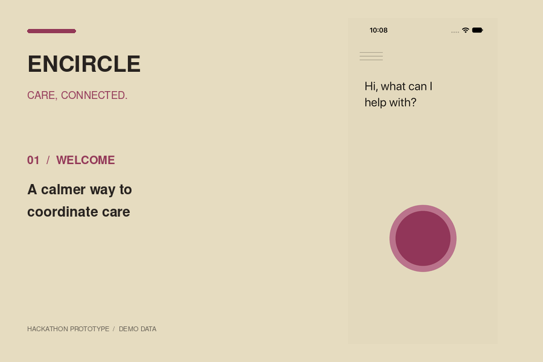
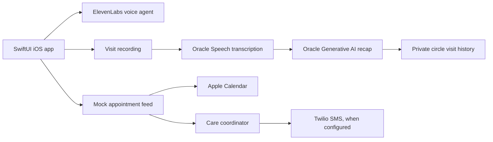

# Encircle

### Care, connected.

**An AI-assisted care companion for remembering appointments, understanding visits, and keeping trusted people informed.**

`SwiftUI` · `iOS 17+` · `ElevenLabs` · `Oracle Cloud` · `Apple Calendar` · `Twilio`

 

*Six-screen visual walkthrough using prototype screenshots. This is a slideshow, not a recording of live AI inference.*

## Why Encircle?

Medical appointments can be overwhelming. Details are easy to forget, and coordinating follow-ups, transportation, and updates with family can take extra effort. Encircle explores a simpler, patient-centered workflow: **speak, capture, recap, and coordinate.**

> **Project status:** Hackathon / proof-of-concept project. The native app and its source code are available, but live voice, cloud transcription, AI summaries, and messaging require separately configured third-party services and credentials. Screenshots and the walkthrough use synthetic/demo content; they do not imply a currently running public service.

## A quick look

| Speak naturally | Review a visit | Coordinate care |
|:---:|:---:|:---:|
|  |  |  |

<b>See more screens</b>

| Appointments | Visit recording | Transport coordination |
|:---:|:---:|:---:|
|  |  |  |

## What it explores

- **Conversational assistance:** An animated, microphone-responsive voice interface backed by ElevenLabs when configured.
- **Visit capture and recap:** Record a visit with consent, transcribe through Oracle realtime Speech, and generate a plain-language summary through Oracle Generative AI.
- **Appointment history:** Revisit transcripts, summaries, and saved recordings; archive individual visits.
- **Trusted care circles:** Create or join a private circle so authorized family members or caregivers can review shared visits.
- **Calendar and transport:** Sync synthetic appointment slots to Apple Calendar and coordinate ride status; SMS delivery is subject to Twilio setup, consent, and sender restrictions.
- **Accessible design direction:** Multilingual translation and broader medication guidance were proposed future enhancements, **not shipped features**.

## How the pieces fit together

The Swift app uses local UI state and secure on-device token storage; the Python backend mediates Oracle services. The app is **not** connected to Epic or a real hospital scheduling system.

## Run the iOS UI locally

1. Clone the repository and open `Encircle.xcodeproj` in Xcode.
2. Select the **Encircle** scheme and an iPhone simulator (iOS 17 or later).
3. Press **⌘R** to build and run.

The basic home interface does not require a paid AI call. To seed a **synthetic visit** in a Debug build, add `--test-summary-home` under **Product → Scheme → Edit Scheme → Run → Arguments Passed On Launch**. A separate `--test-record-visit` launch argument exercises the recording screen for UI checks. Some account, summary, and coordination views require local demo setup or backend data; these launch arguments are not a full offline simulation of every feature.

> The original project documentation reports verification with Xcode 27.1. Fresh builds may require package resolution. Do not commit credentials or actual patient recordings.

## Demo without paid APIs

The [`Preview/`](Preview/) directory contains actual prototype screenshots, and [`Preview/encircle-demo.gif`](Preview/encircle-demo.gif) stitches selected screenshots into a lightweight visual tour. It does **not** run ElevenLabs, Oracle, Calendar, or Twilio.

For a more interactive offline demo, the next step would be to add a separate `DemoMode` data provider that returns synthetic transcripts, summaries, appointments, and notification previews without making network calls. This is **proposed**, not part of the current offline launch flow.

## Technical documentation

| Topic | Reference |
|---|---|
| Recording, transcription, storage, and limitations | [Visit recording plan](Docs/VisitRecordingPlan.md) |
| Mock appointments and test data | [Mock scheduling feed](Docs/MockAppointments.md) |
| Calendar integration | [Apple Calendar](Docs/AppleCalendar.md) |
| Care coordination | [Care coordinator](Docs/CareCoordinator.md) |
| SMS consent and privacy | [SMS consent](Docs/SMSConsent.md) · [Privacy notice](Docs/SMSPrivacy.md) |
| Accounts and care circles | [User accounts](Docs/UserAccounts.md) |
| Backend development | [Server setup](Server/README.md) |

## Privacy and limitations

Encircle is a prototype, not a medical device or substitute for clinical advice. Obtain all participants' consent before recording. AI-generated summaries may be incomplete or inaccurate; confirm medical instructions with a clinician.

---

Built as a four-person hackathon project · Patient-centered care coordination, thoughtfully prototyped.

